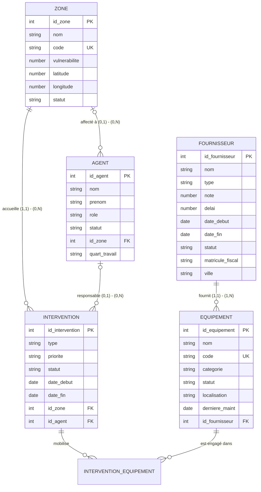

# Smart Weather — Modèles de données

Base : **Oracle 11g XE**, utilisateur `meteo`. Scripts de création : dossier [`SQL/`](../SQL/)
(point d'entrée : [`install_all.sql`](../SQL/install_all.sql)).

## 1. Modèle Entité / Association (MCD)



La base contient **6 tables** : les 5 entités du modèle physique (ZONE, EQUIPEMENT, FOURNISSEUR, AGENT, INTERVENTION)
et la table d'association `INTERVENTION_EQUIPEMENT` (association *Utilise* 1..N / 0..N). La table `STATION` n'existe pas encore : elle référencera `ZONE(id_zone)`
(la couverture réseau vaut 0 % en attendant).

## 2. Modèle relationnel (MLD)

```
ZONE                    (#id_zone, nom, code, vulnerabilite, latitude, longitude, statut)
EQUIPEMENT              (#id_equipement, nom, code, categorie, statut, localisation, derniere_maint, description,
                         id_fournisseur*)
AGENT                   (#id_agent, nom, prenom, role, statut, id_zone*, quart_travail, email, telephone)
INTERVENTION            (#id_intervention, type, priorite, statut, date_debut, date_fin, description,
                         responsable, compte_rendu, id_zone*, id_agent*)
INTERVENTION_EQUIPEMENT (#id_intervention*, #id_equipement*)
FOURNISSEUR             (#id_fournisseur, nom, type, contact, email, telephone, adresse, gouvernorat,
                         matricule_fiscal, ville, note, delai, date_debut, date_fin, statut)
```

`#` clé primaire · `*` clé étrangère.

### Comportement des clés étrangères
| Clé étrangère | Suppression du parent |
|---|---|
| `EQUIPEMENT.id_fournisseur` → FOURNISSEUR | **refusée** (ORA-02292 : un fournisseur qui fournit encore des équipements ne se supprime pas) |
| `INTERVENTION.id_zone` → ZONE | **refusée** (ORA-02292, l'application propose de désactiver la zone) |
| `INTERVENTION_EQUIPEMENT.id_equipement` → EQUIPEMENT | **refusée** (on garde la traçabilité des interventions passées) |
| `INTERVENTION_EQUIPEMENT.id_intervention` → INTERVENTION | **cascade** : l'équipement est libéré |
| `AGENT.id_zone` → ZONE · `INTERVENTION.id_agent` → AGENT | **mise à NULL** (agent « sans zone » / intervention « sans responsable ») |

Toutes les clés étrangères sont indexées (Oracle ne le fait pas automatiquement) par un index dédié
(`IDX_AGENT_ZONE`, `IDX_INTERV_ZONE`, `IDX_INTERV_AGENT`, `IDX_IE_EQUIPEMENT`).

## 3. Modèle physique (MPD) — contraintes principales

| Table | Contraintes |
|---|---|
| **ZONE** | `vulnerabilite` 0..100 (défaut 0) · `latitude` -90..90 · `longitude` -180..180 · `statut` ∈ {Active, Inactive} · `code` unique **sans tenir compte de la casse** (index `UQ_ZONE_CODE` sur `UPPER(code)`, comme `ZoneService::valider`) |
| **EQUIPEMENT** | `categorie` ∈ {Capteurs, Véhicules, Matériel de terrain, Équipements de sécurité} · `statut` ∈ {Disponible, En maintenance, Hors service} · `localisation` obligatoire · `id_fournisseur` obligatoire (FK) · `code` facultatif mais unique (insensible à la casse, `UQ_EQUIPEMENT_CODE`) |
| **AGENT** | `role` ∈ {Technicien Météo, Météorologue, Superviseur, Agent de terrain} · `statut` ∈ {En service, Disponible, En congé, Formation} · `quart_travail` ∈ {Matin (06h-14h), Après-midi (14h-22h), Nuit (22h-06h)} |
| **INTERVENTION** | `type` ∈ {Inondation, Chaleur, Vent fort, Maintenance station, Inspection, Autre} · `priorite` ∈ {Faible, Moyenne, Haute, Critique} · `statut` ∈ {Planifiée, En cours, Terminée, Annulée} · `date_fin ≥ date_debut` · une intervention *Terminée* exige un `compte_rendu` d'au moins 20 caractères · `id_zone` obligatoire |
| **FOURNISSEUR** | `type` ∈ {Capteurs et stations, Maintenance, Énergie, Réseau et télécom, Informatique} · `note` 1..5 · `delai` 1..365 · `date_fin ≥ date_debut` · `statut` ∈ {Actif, Suspendu, Archivé} |

Ces listes de valeurs sont celles du code C++ (`equipment.h`, `fournisseur.h`, `intervention.h`, `emploipage.*`) :
en ajouter une dans le code impose de modifier la contrainte `CHECK` correspondante (sinon Oracle répond ORA-02290).

Oracle 11g n'a pas de colonnes `IDENTITY` : l'auto-incrémentation = séquence (`SEQ_<TABLE>`) + trigger
`BEFORE INSERT` (`TRG_*_ID`). L'application lit elle-même `SEQ_<TABLE>.NEXTVAL` pour connaître l'identifiant de la ligne
insérée ; le trigger sert aux insertions manuelles dans SQL Developer.

## 4. Correspondance avec le code (architecture modèle-vue)

| Couche | Fichiers | Rôle |
|---|---|---|
| Modèle | `Headers/zone.h`, `equipment.h`, `fournisseur.h` + `Sources/zone.cpp`, `equipment.cpp`, `fournisseur.cpp` | Entité : `ajouter()`, `modifier()`, `supprimer(id)`, `afficher()` — requêtes préparées (`prepare` + `bindValue`) |
| Modèle | `Headers/connection.h`, `Sources/connection.cpp` | Connexion Oracle unique (Singleton) |
| Métier | `zoneservice.cpp`, `equipmentservice.cpp`, `interventionservice.cpp` | Règles métier + validations (sans accès BD) |
| Intermédiaire | `zonerepository.cpp`, `equipmentrepository.cpp`, `fournisseurrepository.cpp` | Appelle l'entité, garde la liste en mémoire, émet `changed()` |
| Vue | `*page.*`, `*dialog.*`, `coveragepage.*`, `mapwidget.*`, `smartsupply.*` | Interface : aucune requête SQL |
