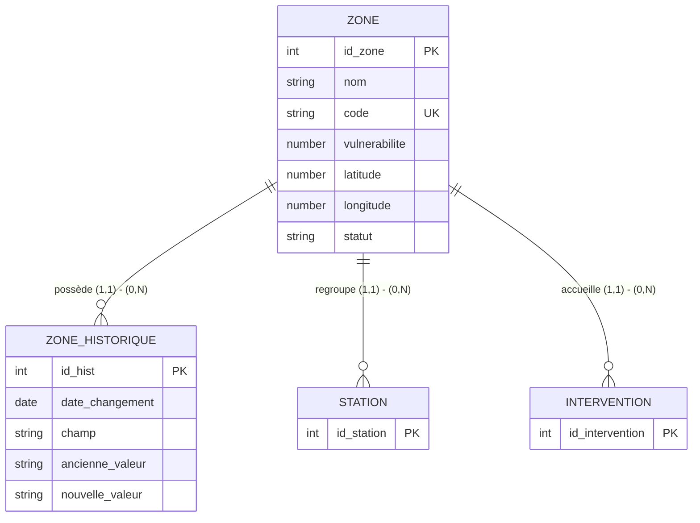

# Smart Weather — Gestion des Zones : modèles de données

Module : **Stations & Zones — Zones** (Adem Nouioui). Base : Oracle 11g XE, utilisateur `meteo`.
Script de création : [`SQL/zones_oracle.sql`](../SQL/zones_oracle.sql).

## 1. Modèle Entité / Association (MCD)



`STATION` (Tasnim) et `INTERVENTION` (Bader) sont gérées par les autres membres : seule leur clé étrangère vers `ZONE` est
décrite ici. Cardinalités : une zone possède 0 à N stations / interventions / lignes d'historique ; chacune appartient à
exactement une zone.

## 2. Modèle relationnel (MLD)

```
ZONE            (#id_zone, nom, code, vulnerabilite, latitude, longitude, statut)
ZONE_HISTORIQUE (#id_hist, id_zone*, date_changement, champ, ancienne_valeur, nouvelle_valeur)
STATION         (#id_station, ..., id_zone*)        -- géré par Tasnim
INTERVENTION    (#id_intervention, ..., id_zone*)   -- géré par Bader
```

`#` clé primaire · `*` clé étrangère vers `ZONE(id_zone)`.
Contraintes : `code` unique · `0 ≤ vulnerabilite ≤ 100` · `-90 ≤ latitude ≤ 90` · `-180 ≤ longitude ≤ 180` ·
`statut ∈ {Active, Inactive}` · suppression d'une zone → son historique est supprimé (`ON DELETE CASCADE`) ;
suppression refusée si des stations / interventions la référencent.

## 3. Modèle physique (MPD, Oracle 11g)

| Table | Colonne | Type | Contraintes |
|---|---|---|---|
| **ZONE** | ID_ZONE | NUMBER(10) | PK (`PK_ZONE`), alimentée par `SEQ_ZONE` |
| | NOM | VARCHAR2(100) | NOT NULL |
| | CODE | VARCHAR2(20) | NOT NULL, UNIQUE (`UQ_ZONE_CODE`) |
| | VULNERABILITE | NUMBER(4,1) | NOT NULL, défaut 0, CHECK 0..100 |
| | LATITUDE | NUMBER(9,6) | NOT NULL, défaut 36.8065, CHECK -90..90 |
| | LONGITUDE | NUMBER(9,6) | NOT NULL, défaut 10.1815, CHECK -180..180 |
| | STATUT | VARCHAR2(10) | NOT NULL, défaut 'Active', CHECK IN ('Active','Inactive') |
| **ZONE_HISTORIQUE** | ID_HIST | NUMBER(10) | PK, alimentée par `SEQ_ZONE_HISTORIQUE` |
| | ID_ZONE | NUMBER(10) | NOT NULL, FK → ZONE(ID_ZONE) ON DELETE CASCADE |
| | DATE_CHANGEMENT | DATE | NOT NULL, défaut SYSDATE |
| | CHAMP | VARCHAR2(50) | NOT NULL |
| | ANCIENNE_VALEUR / NOUVELLE_VALEUR | VARCHAR2(200) | — |

Oracle 11g n'a pas de colonnes `IDENTITY` : l'auto-incrémentation = séquence + trigger `BEFORE INSERT`
(`TRG_ZONE_ID`, `TRG_ZONE_HISTORIQUE_ID`).

## 4. Correspondance avec le code (architecture modèle-vue)

| Couche | Fichiers | Rôle |
|---|---|---|
| Modèle | `Headers/zone.h`, `Sources/zone.cpp` | Entité `Zone` : `ajouter()`, `modifier()`, `supprimer(id)`, `afficher()` — requêtes préparées (`prepare` + `bindValue`) |
| Modèle | `Headers/connection.h`, `Sources/connection.cpp` | Connexion Oracle unique (Singleton) |
| Métier | `Sources/zoneservice.cpp` | Les 5 métiers avancés + validations (sans accès BD) |
| Intermédiaire | `Sources/zonerepository.cpp` | Appelle `Zone`, garde la liste en mémoire, émet `changed()` pour rafraîchir l'affichage |
| Vue | `zonespage.*`, `zonedialog.*`, `zonedetailsdialog.*`, `coveragepage.*`, `mapwidget.*` | Interface : aucune requête SQL |
